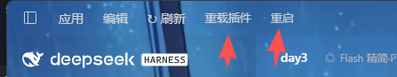

# dsh-quick-restart



给 **DeepSeek Harness（DSH）** 标题栏加两个按钮：**重载插件代码**（不用关程序）和 **重启 DSH**。

> 中文为主，末尾有简短的 English 说明。

## 它解决什么问题

DSH 的第三方插件改了代码之后，默认要**完全退出再打开**才生效（刷新页面没用，热重载也不会自动发生）。
这个插件在标题栏菜单栏加两个按钮，把这件事变成点一下：

- **重载** —— 只重新加载第三方插件，主进程和会话都不动，实测 8/8 成功；
- **重启** —— 关掉并重开 DSH（需要另外安装 [`dsh-hot-restart`](https://github.com/InariNGT-Ofiicial/dsh-hot-restart) 提供重启引擎，没装就只有"重载"可用）。

## 安装

### 方式一：从 GitHub Release 装（已发布）

```
https://github.com/a994903574/dsh-quick-restart/releases/download/v0.1.1/dsh-quick-restart-0.1.1.tgz
```

把这个地址填进 DSH 的插件安装入口即可（和装其它第三方插件一样）。

### 方式二：从 npm 市场装（尚未发布，等账号开通）

DSH 设置页 →「插件」→ 搜索 `dsh-quick-restart` → 安装 → **完全退出 DSH 再打开**（首次必须，按钮要用宿主启动时的注入表）。

或者手动：

```bash
cd <你的 DSH profile 目录>
pnpm add dsh-quick-restart
```

并在 profile 的 `package.json` 里把它加进 `dsh.profile.bundles`。

## 用起来什么效果

标题栏菜单栏（文件/编辑那一条的右侧）多出两个小按钮：**重载**、**重启**。
点"重载"后，按钮会短暂显示结果；如果有插件重载失败，鼠标悬停能看到是哪个包、什么错误。

## 边界（老实说）

- **只重载第三方插件**。`@deepseek-ai/*`（宿主内置，在 app.asar 里）和 `cordis:*`（虚拟分组）会被跳过——碰它们必然失败。
- **前端 bundle 不会跟着换**。插件如果带前端界面，重载后界面那段还是旧的，得重启程序。这是宿主机制，不是本插件的问题。
- **重启按钮依赖 `dsh-hot-restart`**。没装也能用"重载"，只是重启那颗点了没反应。
- 仅测试于 **Windows 桌面版**。其他平台未验证。

## 卸载

```bash
pnpm remove dsh-quick-restart
```
再从 `dsh.profile.bundles` 里删掉对应条目，重启 DSH。

## 它是怎么做的（给好奇的人）

桌面壳的 `index.html` 直接读安装包里的静态 dist，不走 `renderIndex`，所以 `webServer.tapIndex` 无效。
唯一可用的通道是宿主启动时**一次性收集**的 `webserver/index-inject` 注入表——所以插件里不能写对象级 `inject = ['webServer']`，
否则 `apply()` 会推迟到 webServer 就绪之后，错过那次收集，界面上永远看不到按钮。这一点已在代码注释里写明。

重载本身是：取 loader 的 entries → 清掉该包在 `loader.internal.loadCache` 里的模块 → 重新 import → 用新插件替换旧的 fiber。

## English (short)

**dsh-quick-restart** adds two titlebar buttons to DeepSeek Harness: **reload** third-party plugins without restarting the app, and **restart** DSH
(the latter requires `dsh-hot-restart`). Built-in `@deepseek-ai/*` plugins and front-end bundles are intentionally not hot-reloaded — that's a host limitation.
Tested on Windows desktop only. MIT licensed.

## License

MIT
